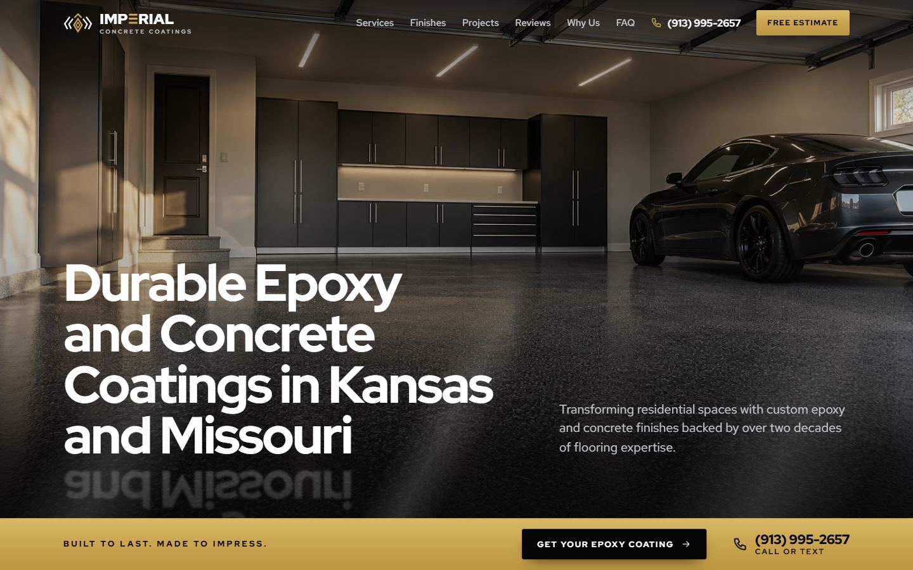

<div align="center">


# Imperial Concrete Coatings

**Site institucional one page para uma empresa de revestimentos de epóxi e concreto em Olathe, Kansas.**

*Built to last. Made to impress.*

[imperialconcretecoatings.com](https://imperialconcretecoatings.com/)

<br>



</div>

<br>

## Sobre o projeto

A Imperial Concrete Coatings é uma empresa familiar que aplica revestimentos de epóxi e concreto em garagens, porões, pátios e decks de piscina na região metropolitana de Kansas City.

O site é a página de destino das campanhas de Google Ads, Meta Ads e Google Business Profile. Ele tem um trabalho só: transformar a visita em pedido de orçamento, ligação ou mensagem.

O visual nasceu da logo da empresa: mármore preto, dourado e branco.

Este repositório contém exatamente o que vai para o servidor. A raiz do repositório é a raiz do site.

## O que tem na página

| Seção | Destaque |
|---|---|
| Hero | Garagem com piso de epóxi, título e ação principal na primeira tela |
| Services | Cinco cards em imagem, com a descrição no hover |
| See the Finish on the Floor | Seletor interativo: o acabamento escolhido se espalha por um piso em perspectiva, desenhado no navegador |
| Where We Coat | Garagem, porão, pátio e deck de piscina |
| Bare Concrete or a Coated Floor | Comparativo lado a lado |
| Recent Projects | Esteira de imagens em rolagem contínua |
| Why Choose | Painel de vidro com os três diferenciais |
| Getting Started | Três passos ligados por uma linha de luz |
| FAQ | Seis perguntas frequentes |
| Free Estimate | Formulário em três etapas e mapa |

No celular, uma barra fixa mantém **Call** e **Free Estimate** sempre a um toque.

## Tecnologia

- HTML, CSS e JavaScript puros, sem framework e sem etapa de build
- [GSAP](https://gsap.com/) com ScrollTrigger para o movimento
- Fontes Red Hat Display e Red Hat Text, hospedadas junto com o site
- Texturas dos acabamentos geradas em `<canvas>`, sem imagens extras
- Endpoint em PHP para o formulário, com validação e honeypot
- Entradas suaves que respeitam `prefers-reduced-motion`

## Estrutura

```
.
├── index.html
├── 404.html               página de erro
├── privacy-policy.html
├── terms-of-use.html
├── contact.php            envio do formulário, com anti-spam
├── assets/
│   ├── css/styles.css
│   ├── js/                main.js, GSAP e ScrollTrigger
│   ├── fonts/
│   ├── icons/             ícones do manifest
│   └── img/               logo, fotos reais em projects/ e ilustrações em generated/
├── .htaccess              HTTPS sem www, 404, cache, compressão, segurança e anti-spam
├── robots.txt, sitemap.xml, llms.txt, humans.txt
├── site.webmanifest, favicon.ico, favicon-32.png, apple-touch-icon.png
└── .well-known/security.txt
```

## Rodando localmente

O site é estático. Qualquer servidor de arquivos serve:

```bash
npx serve .
```

Para testar o envio do formulário é preciso PHP:

```bash
php -S localhost:8000
```

## Publicação

1. Envie o conteúdo deste repositório para a raiz do domínio na Hostinger.
2. Ative a exibição de arquivos ocultos e confira se `.htaccess` e `.well-known/` subiram.
3. Abra o site e teste o formulário.

O `.htaccess` nega acesso ao `README.md` e às pastas ocultas, então eles não ficam públicos no site mesmo que sejam enviados.

## Anti-spam

O formulário tem seis camadas, sem captcha para o visitante:

- Campo oculto (honeypot) que só robôs preenchem.
- Tempo mínimo de 3 segundos com a página aberta antes do envio.
- Limite de 5 envios por hora por endereço IP.
- Origem obrigatória: só aceita envios feitos a partir de imperialconcretecoatings.com (no PHP e no `.htaccess`).
- Recusa links e marcação em campos curtos como nome e ZIP.
- Opções de espaço e acabamento precisam bater com as do formulário.

Envios suspeitos recebem a mesma resposta de sucesso, sem e-mail, para o robô não aprender a contornar.

## Formulário

1. O navegador envia o pedido ao `contact.php`, que aplica o anti-spam.
2. Aprovado, o `contact.php` repassa o lead em JSON para o webhook e responde `relay: true`.
3. Só então o navegador envia o pedido ao Web3Forms, que manda o e-mail.

O endereço do webhook tem um token e fica em `config.php`, que **não está no repositório**. Na Hostinger, copie `config.example.php` para `config.php` e cole o endereço real, ou suba o `config.php` que está na pasta local do projeto. Sem esse arquivo o e-mail continua chegando, mas o lead não vai para o webhook (o motivo fica no log de erros do PHP).

Nesta cópia de portfólio a chave do Web3Forms (`data-web3forms` no `index.html`) e o endereço do webhook foram retirados. Preencha com os seus para usar o formulário.

## Antes de lançar

- [ ] Trocar as imagens ilustrativas geradas por IA por fotos reais dos serviços
- [ ] Publicar avaliações reais de clientes
- [ ] Completar o FAQ com o sistema aplicado e os prazos
- [ ] Ligar o envio do formulário (`LIVE = true` em `contact.php`)
- [ ] Revisar a Privacy Policy e os Terms of Use com o cliente (e, se possível, com um advogado)

> [!NOTE]
> As imagens do site são ilustrativas, geradas por IA. Elas mostram os acabamentos, não trabalhos executados pela empresa.

## Cache

CSS e JavaScript ficam em cache por um ano. Depois de alterar `styles.css` ou `main.js`, troque o carimbo `?v=` em `index.html`, `404.html`, `privacy-policy.html` e `terms-of-use.html`. As imagens ficam em cache por um mês, então uma imagem substituída precisa de um nome de arquivo novo.

## Créditos

- Desenvolvido por [Eu Sou TS](https://eusouts.com.br/)
- Imagens: ilustrações geradas por IA
- Fontes: Red Hat Display e Red Hat Text (SIL Open Font License)
- Animação: GSAP

<div align="center">
<br>

© 2026 Imperial Concrete Coatings

</div>
